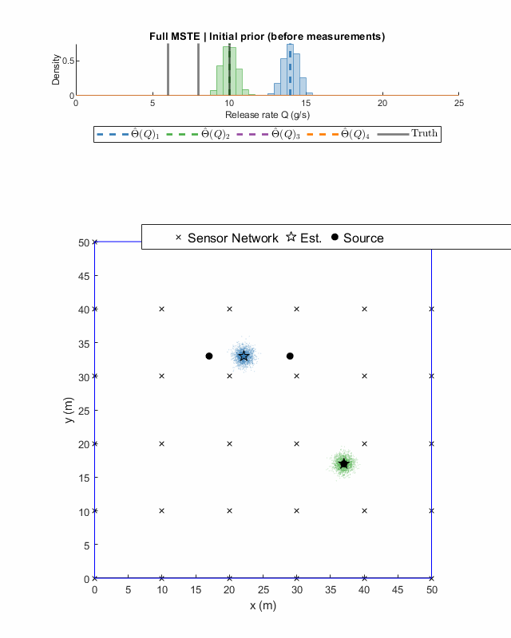

# MultiSTE filter for a static sensor network

Estimate the **number, positions and release rates of multiple gas sources**
from superposed concentration measurements. This MATLAB implementation uses a
joint-state particle filter with physics-informed merging/removal alongside
source birth and death.

[Quick start](#quick-start) · [Examples](#three-examples) ·
[Settings and user guide](docs/USAGE.md) ·
[Paper / preprint](https://arxiv.org/abs/2512.17001)

## See the filter in action

**Recovering three sources from an initial belief containing only two.**
The initial particles represent the two nearby true sources as one stronger
source. Birth events and subsequent measurement updates allow the filter to
recover distinct source hypotheses.



*Illustrative single run with three true sources. Playback is accelerated.*

## Quick start

Open the repository folder in MATLAB and run:

```matlab
main
```

For an animated recovery demonstration:

```matlab
cfg = mste_config('recovery');
cfg.plot.live = true;           % optional; rendering slows the demonstration
result = run_mste_demo(cfg);
```

The live display shows the evolving source locations and release-rate
histograms. Results and summary figures are saved under `Results/`.
To replot a saved result without rerunning the filter, use `plot_mste_results`.

To record a short GIF for this page, run `make_readme_animation`.
See [recording and adding an animation](docs/ANIMATION.md).

## Three examples

Select the example with `mste_config`, then call `run_mste_demo(cfg)`.

| Example | What it demonstrates |
|---|---|
| `'standard'` | Estimate unknown sources from a broad initial prior |
| `'ablation'` | Compare the full filter with merge/removal disabled, using the same initial particles and measurements |
| `'recovery'` | Recover from a concentrated merged two-source belief when three sources are present |

These are single-trial demonstrations of the filter's working principles.
The release includes **five predefined source configurations**, custom source
and sensor layouts, and editable settings. Monte Carlo runners, the PHD baseline
and robot planning are outside this release.

## Change the setup

```matlab
cfg = mste_config('standard');
cfg.sourceConfig = 4;           % one of five predefined configurations
cfg.nTrueSources = 3;
cfg.Mmax = 4;                   % maximum sources represented by a particle
cfg.Np = 10000;
cfg.wind.directionDeg = -90;
result = run_mste_demo(cfg);
```

See the [user guide](docs/USAGE.md) for all settings, custom source layouts,
plot options, metric definitions and the interface for future mobile sensing.

## Requirements

- MATLAB with **Statistics and Machine Learning Toolbox**.
- Target version: **MATLAB R2024b**.
- No Parallel Computing, Mapping or Robotics toolbox is needed by these demos.

## Paper and credits

**Mr.MSTE: Multi-robot Multi-Source Term Estimation with Wind-Aware Coverage Control**

Rohit V. Nanavati, Timothy J. Glover, Matthew J. Coombes and Cunjia Liu.

[Paper / preprint](https://arxiv.org/abs/2512.17001) · [Citation](CITATION.cff)

Original software: **Rohit V. Nanavati and Cunjia Liu**. Maintainer: **Cunjia Liu**.
Updates to the demonstrations, debugging, plotting and documentation were
prepared with assistance from OpenAI ChatGPT/Codex. See [AUTHORS.md](AUTHORS.md)
for credits and [CHANGES.md](CHANGES.md) for implementation notes.
